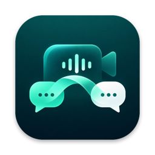
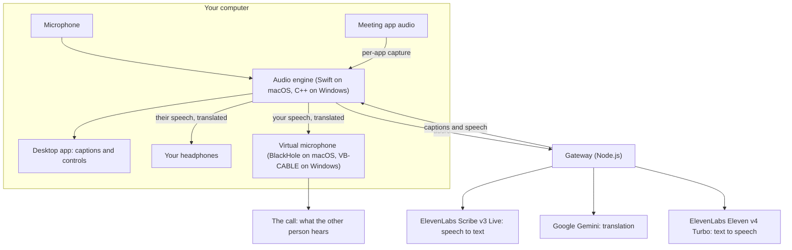
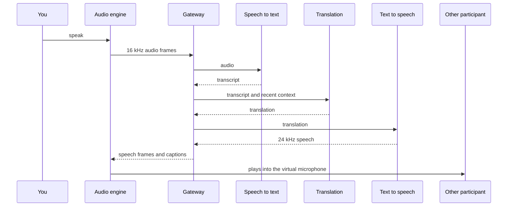

<p align="center"></p>

# LiveBridge AI

**A real-time speech interpreter for calls on macOS and Windows.** You speak your language; the other person hears theirs, a
moment later, in a synthesized voice — and their reply comes back to you as captions and speech in your language.
It works with Zoom, Google Meet and any other meeting app, and the other participant installs nothing.

[](https://github.com/JaysonKhan/livebridge/releases/latest)
[](LICENSE)


[](https://github.com/sponsors/JaysonKhan)

> **Status:** a working personal tool, built in the open. It runs end to end on real hardware with real providers
> and is used by its author in Google Meet calls. Read [Status and limits](#status-and-limits) before you rely on it.

---

## Contents

- [What it does](#what-it-does)
- [How it works](#how-it-works)
- [Modes and turn-taking](#modes-and-turn-taking)
- [Languages and voice](#languages-and-voice)
- [Three ways to connect](#three-ways-to-connect)
- [Safeguards](#safeguards)
- [Requirements](#requirements)
- [Quick start](#quick-start)
- [Using it in a call](#using-it-in-a-call)
- [Configuration](#configuration)
- [Privacy](#privacy)
- [Project layout](#project-layout)
- [Tests](#tests)
- [Documentation](#documentation)
- [Status and limits](#status-and-limits)
- [Support the project](#support-the-project)
- [License](#license)

---

## What it does

- **Two-way interpreting in a live call.** Your speech is translated and spoken into the call; the other person's
  speech is translated and played in your headphones. Both sides are also shown as live captions.
- **Fast.** Translated speech starts about **1.4 seconds** after you stop talking (measured — see
  [How it works](#how-it-works)).
- **90 languages.** Uzbek ↔ English by default; pick any two languages from the list.
- **Nothing to install on the other side.** The translated voice reaches the call through a virtual microphone, so
  to Zoom or Meet it is just a microphone.
- **Honest by design.** The app will not start a session until you confirm the other participants were told an AI
  interpreter is in use. No audio is recorded, and nothing is stored unless you export it.
- **macOS and Windows.** The same app on both, with each system's own look: a DMG for the Mac, an installer for
  Windows 10 and 11.
- **Choose the voices.** Pick the voice your translated speech is spoken in, and the voice of the other person —
  search, filter and listen to samples first.
- **Interface in four languages:** Uzbek, Russian, Turkish and English.
- **Extras:** export the conversation as Markdown, rate individual translations, and a local numbers-only log of
  speed and errors.

## How it works

LiveBridge has three parts: a **desktop app** (Flutter) for controls and captions, a native **audio engine** that
captures and plays sound (Swift on macOS, C++ on Windows), and a **gateway** (Node.js) that talks to the AI
providers. The API keys live in the gateway; the app holds a key only in the *Own keys* connection (see
[Three ways to connect](#three-ways-to-connect)), in the system's secret store.



### One turn, step by step



1. **Capture.** The engine reads your microphone straight from the system (Core Audio on macOS, WASAPI on Windows)
   and resamples it to 16 kHz mono. For the other direction it captures the audio of the meeting app you selected —
   only that app, never the whole system.
2. **Transport.** Audio travels to the gateway over one WebSocket as small binary frames, each tagged with its
   direction, a sequence number and a turn id. Control messages are JSON.
3. **Speech to text.** The gateway streams the audio to ElevenLabs Scribe v3 Live. Partial transcripts become live
   captions; the final transcript of a turn moves on.
4. **Translation.** The whole turn is translated as one unit by Google Gemini, with the last few turns as context
   for names and terminology. Translating whole turns protects negation and meaning. The model's answer is checked
   before anything is spoken: empty, runaway or structured output is rejected and never read aloud.
5. **Text to speech.** The translation is spoken by ElevenLabs Eleven v4 Turbo and streamed back as 24 kHz audio.
6. **Playback.** Your translated speech is written to the virtual microphone — **BlackHole 2ch** on macOS,
   **VB-CABLE** on Windows — which the meeting app uses as its microphone. The other person's translated speech is played in your headphones.

The two directions are completely separate pipelines that share nothing but the connection, so one being busy never
delays the other.

### Measured speed

| What | Result |
|---|---|
| End of speech → translated speech audible (real hardware, 24 turns) | median **1.35–1.41 s**, slowest 1.81 s |
| Gateway benchmark, first translated audio (120 turns) | p50 **1.33 s**, p95 2.49 s |
| Translation alone | about 0.5–0.65 s |
| Speech synthesis, first audio | about 0.2–0.3 s |
| End of speech → first translated audio at the computer, gateway on a server next to the providers (6 turns) | median **0.81 s** (1.03 s with the gateway on the same computer) |

Measured with synthetic speech for Uzbek ↔ English and Russian (`docs/benchmark.md`). Other language pairs work but
have not been measured.

## Modes and turn-taking

**Session mode** — what is produced:

| Mode | Captions | You hear them in your language | They hear you in theirs |
|---|:---:|:---:|:---:|
| Captions only | ✅ | — | — |
| Incoming audio | ✅ | ✅ | — |
| Bidirectional speech | ✅ | ✅ | ✅ (needs a virtual microphone) |

**Turn mode** — when your speech is sent:

| Mode | How it works |
|---|---|
| Push-to-talk | Hold the button or the **Space** key while you speak. The most predictable option. |
| Auto: VAD | Your speech is sent when you pause. |
| Auto: turn prediction | The speech model predicts when you have finished a thought. |

Automatic modes keep the microphone open, so wear headphones.

During a session the switch **Hold to talk | Automatic** above the talk panel changes the mode at once, without
restarting (Automatic is the last automatic mode chosen in the setup, VAD at first). The panel's bars follow your
microphone level while it is being sent — teal with moving bars means you are heard; flat grey bars mean nothing is
sent. Switching during a session needs a gateway from this version or later; an older one keeps the mode the session
started with.

## Languages and voice

**Languages.** Each side of the conversation is chosen from a list of **90 languages** — the languages that Eleven v4
can speak and that realtime speech-to-text can recognise. The default is Uzbek ↔ English. The full table is in
[`packages/protocol/src/languages.ts`](packages/protocol/src/languages.ts).

**Voice.** Both directions default to **JaysonKhan - Natural Uzbek Voice** (`ehTFHBkERkWR22A3sR8M`): the author's own
voice, published by the author in the ElevenLabs Voice Library. Voice Library voices need a paid ElevenLabs plan; if
your account rejects the id, add the voice to *My Voices* from the Voice Library and use the id shown there. To
speak in your own voice, put your own clone's id in `ELEVENLABS_OWNER_VOICE_ID`, or choose it in the app. The other
participant's voice is never cloned.

**Choosing voices in the app.** The **Voices** group in the setup column has a row for each direction — *My voice
(outgoing)* and *Their voice (incoming)*. **Change** opens the voices of the gateway's ElevenLabs account: search by
name, filter by gender, age, accent, language and use, listen to a sample, then click a voice. **Default** goes back
to the voice the gateway is configured with. A row is switched off when the selected mode speaks nothing in that
direction. The list needs the access token, and the gateway's ElevenLabs key needs the *voices read* permission;
without it the picker says the list is not available and sessions keep the configured voices.

## Three ways to connect

On first launch the app asks how it should reach the translation service. Nothing else changes between the ways:
same modes, languages and voices.

- **Your account (the hosted service).** Press **Sign in with Google**: the app shows a short code and opens the
  site in the browser, where you approve it. A new account has a **5-minute trial**; more minutes are bought in
  packages with **Top up** (the app lists the site's packages and opens the checkout in the browser; prices are shown
  before tax). The main screen shows the balance as "≈ N min" next to **Top up**, **Account page** and
  **Sign out**. Start is blocked while the balance is known to be empty. Apple sign-in is not available yet.
- **Own keys.** Open *I have my own API keys* and enter an ElevenLabs and a Gemini key. They stay in the Keychain
  (macOS) or Credential Manager (Windows), are sent to the hosted gateway for each session and are not stored
  there, and nothing is charged to an account.
- **Own gateway.** Under *Own keys*, *Own gateway*: the address of a gateway you run yourself and its access token
  (`docs/deployment.md`). An existing install that already had a saved token opens in this mode and skips the
  onboarding.

The setup panel shows a one-line summary of the connection with **Change** (other modes: **Change connection**);
**Back** on the choice screen returns to the connection you left, without entering its keys or signing in again.
Voices are remembered per connection, because each one offers its own list. The account's access token lasts about
15 minutes, lives in memory only and is refreshed in the background during a call; the refresh token is kept in the
Keychain / Credential Manager. A session ends with a banner when the balance runs out, billing cannot be reached,
10 minutes pass without speech, the account continues on another device, or the service is busy.

## Safeguards

- **Consent first.** Before every session the app shows a disclosure sentence and will not start until you confirm
  the other participants were informed and agreed. A capture indicator stays visible for the whole session.
- **Panic stop.** **Esc** drops everything queued, silences the virtual microphone and closes the session.
- **Mute and bypass.** Mute either direction at any time, or switch to your real, untranslated microphone.
- **It only interprets.** Speech is passed to the model as quoted data; the prompt forbids answering questions or
  following instructions heard in speech.
- **Crosstalk filters.** Speech that is already in a lane's target language (usually the other side's voice reaching
  your microphone) is shown but not translated or spoken, and the session's own synthesized speech coming back
  through a microphone is ignored instead of being translated again.
- **No recording.** Audio is never stored. Captions live in memory only, unless you export them yourself.

## Requirements

| | |
|---|---|
| **Mac** | macOS 14.2 or newer (developed on Apple Silicon) |
| **Windows PC** | Windows 10 or 11, 64-bit. Hearing the meeting app (*Incoming audio*, *Bidirectional speech*) needs Windows 11 or Windows 10 build 20348 or newer |
| **Build tools** | Flutter (Dart 3.13+) and Node.js 22.18+; Xcode with Swift for macOS, Visual Studio with C++ for Windows (the Windows app is also built by this repository's GitHub workflow) |
| **Connection** | A Google account for the hosted service, **or** your own ElevenLabs (speech to text + text to speech) and Google Gemini keys, **or** your own gateway (which holds those keys) |
| **Virtual microphone** | Only for *Bidirectional speech*: [BlackHole 2ch](https://existential.audio/blackhole/) on macOS, [VB-CABLE](https://vb-audio.com/Cable/) on Windows |
| **Headphones** | Strongly recommended: speakers feed the translated voice back into the microphone |

## Quick start

**Download:** the [Releases page](https://github.com/JaysonKhan/livebridge/releases/latest) has the DMG for macOS
and the installer for Windows. Both contain the app only: sign in with your account or enter your own keys in the app, or run your own gateway (steps 1–2 below).

- **macOS:** open the DMG and drag **JK - LiveBridge** to Applications. It is not notarised, so the first launch
  needs **System Settings → Privacy & Security → Open Anyway**.
- **Windows:** run `JK-LiveBridge-<version>-windows-setup.exe`; it installs for your user, no administrator rights
  needed. It is not code-signed, so SmartScreen asks first: **More info → Run anyway**. The app is in the Start menu
  as **JK - LiveBridge**.

Or build everything from source:

### 1. Try it without any keys

Fake providers return placeholder text and test tones, so you can see the whole flow working first.

```bash
npm install
export LB_TOKEN=$(openssl rand -base64 36) && echo "access token: $LB_TOKEN"
PROVIDER_MODE=fake GATEWAY_ACCESS_TOKEN=$LB_TOKEN npm run gateway
```

In a second terminal:

```bash
cd apps/desktop && flutter build macos --release
open "build/macos/Build/Products/Release/JK - LiveBridge.app"
```

The app shows up as **JK - LiveBridge** in the Dock, Finder and Spotlight (type "JK" to find it).

In the app: mode **Captions only**, gateway address `http://127.0.0.1:8201`, paste the token, press
**Start session**, hold **Space** and speak. You will see placeholder text under a `MOCK PROVIDERS` banner — that is
not a translation.

### 2. Real translation

```bash
cp .env.example .env     # fill in the keys and a GATEWAY_ACCESS_TOKEN (openssl rand -base64 36)
npm run probe            # checks every provider call the gateway will make
npm run gateway
```

Then start a session in the app as above. On first launch macOS asks for two permissions — allow both:
**Microphone**, and **System Audio Recording** (used only for the meeting app you select). On Windows, check that
**Settings → Privacy & security → Microphone → Let desktop apps access your microphone** is on.

### 3. Package it

**macOS — a DMG:**

```bash
./scripts/make-dmg.sh    # builds the app and writes dist/JK-LiveBridge-<version>.dmg
```

Open the DMG and drag **JK - LiveBridge** to Applications. The released app is signed with a self-signed
certificate (not Apple's) and is not notarised, so on another Mac the first launch is blocked: open **System Settings
→ Privacy & Security** and press **Open Anyway**. The certificate stays the same from release to release, so the
Keychain does not ask again after each update. A build without that certificate (yours, from source) is ad-hoc signed
instead.
The DMG contains the app only — the gateway still has to run (step 2).

**Windows — an installer:** every push to `main` that touches the app runs the *Windows* GitHub workflow, which
builds the app, runs the engine core's tests and attaches `JK-LiveBridge-<version>-windows-setup.exe` to the run
(artifact `JK-LiveBridge-windows-setup`). To build it yourself on Windows: `flutter build windows --release` in
`apps/desktop`, then compile `apps/desktop/windows/installer.iss` with Inno Setup 6 (`LB_VERSION` set to the version).

## Using it in a call

1. Install the virtual microphone once and restart the computer: on macOS `brew install blackhole-2ch`, on Windows
   [VB-CABLE](https://vb-audio.com/Cable/).
2. In the meeting app set **Speaker → your headphones** and **Microphone → BlackHole 2ch** (macOS) or
   **CABLE Output** (Windows; LiveBridge plays your translation into **CABLE Input**).

   | App | Where |
   |---|---|
   | Zoom | Settings → Audio |
   | Google Meet / Zoom in a browser | the audio settings of the call |

3. In LiveBridge choose your language and theirs, mode **Bidirectional speech**, and tick the meeting app under
   **Meeting source** (open the call first, then press **Refresh**).
4. Read the disclosure sentence to the other participant, confirm, and start the session.

The full walkthrough, including troubleshooting, is in [`docs/setup-guide.md`](docs/setup-guide.md) (in Uzbek).

## Configuration

Everything is set in `.env` and validated when the gateway starts; a missing or malformed value stops it with a
clear message. The settings you are most likely to touch:

| Variable | Meaning |
|---|---|
| `GATEWAY_ACCESS_TOKEN` | Client credential (32+ characters). The app keeps it in the macOS Keychain or the Windows Credential Manager. |
| `ELEVENLABS_API_KEY`, `GEMINI_API_KEY` | Provider keys. They never leave the gateway. |
| `ELEVENLABS_OWNER_VOICE_ID` | Voice of your translated speech when none is chosen in the app. |
| `ELEVENLABS_INCOMING_VOICE_ID` | Voice of the other participant's translated speech when none is chosen in the app. |
| `VOICES_EXCLUDED_CATEGORIES` | Voice categories left out of the list the app can choose from (comma-separated; empty by default). |
| `TRANSLATION_MODEL` / `TRANSLATION_FALLBACK_MODEL` | Gemini models; the fallback is used when the primary fails. |
| `PROVIDER_MODE` | `real`, or `fake` for placeholder providers. |
| `PORT` | Gateway port (default `8201`). |

See [`.env.example`](.env.example) for the complete list with comments.

## Privacy

- **Audio** leaves your computer only during a session you started, goes to the gateway you connected to and from
  there to the providers. LiveBridge does not store it.
- **Captions** are kept in memory and disappear when the session ends. **Export** writes a Markdown file only when
  you ask for it.
- **Analytics** are local and numbers-only: timings, counts, error codes and your ratings — never what was said.
- **Sharing statistics is on by default — numbers only.** The same numbers are sent with a random install id, so that
  errors reach the developer; the totals are public at
  [jaysonkhan.com/services/livebridge](https://jaysonkhan.com/services/livebridge/). Switch it off any time in the
  Analytics panel (**Share anonymous statistics**); a choice to switch it off is kept across updates.
- **Report a problem** (the bug icon) sends your description and, unless you untick it, a diagnostic log of devices,
  settings, errors and timings — never what was said, keys or tokens. You see exactly what is sent first.
- The providers process what you send them under their own terms.

Details: [`docs/privacy.md`](docs/privacy.md) and [`docs/telemetry-api.md`](docs/telemetry-api.md).

## Project layout

```text
apps/desktop/                          Flutter app: UI, state, localisation, tests
apps/desktop/native/LiveBridgeAudio/   Swift audio engine for macOS (library + `lbaudio` command-line tool + tests)
apps/desktop/native/livebridge_core/   portable C++ engine core used by the Windows app (+ tests)
apps/desktop/windows/                  Windows runner: WASAPI audio, per-app capture, installer script
apps/desktop/macos/                    Xcode runner: links the engine, bridges it to Flutter
services/gateway/                      Node.js gateway: sessions, pipelines, provider adapters, probe, benchmark
packages/protocol/                     Wire protocol: binary audio frame, JSON messages, language table
tests/integration/                     Gateway tests against fake providers and local mock provider servers
infra/                                 Dockerfile, compose file, systemd unit, nginx sample
docs/                                  Setup guide, privacy, benchmark, contracts, deployment
```

## Tests

```bash
npm run typecheck && npm test                              # protocol, gateway, provider adapters
(cd apps/desktop/native/LiveBridgeAudio && swift test)     # audio engine
(cd apps/desktop && flutter analyze && flutter test)       # app
```

No automated test calls a real API: they use deterministic fake providers or local mock servers. `npm run probe`
and `npm run bench` are the tools that exercise the real providers.

## Documentation

| File | What it covers |
|---|---|
| [`IMPLEMENTATION_STATUS.md`](IMPLEMENTATION_STATUS.md) | What is verified, with commands and actual results |
| [`docs/setup-guide.md`](docs/setup-guide.md) | Step-by-step setup and troubleshooting (Uzbek) |
| [`docs/privacy.md`](docs/privacy.md) | Data handling, consent and conduct |
| [`docs/benchmark.md`](docs/benchmark.md) | Latency measurements and how they were taken |
| [`docs/bridge-contract.md`](docs/bridge-contract.md) | Contract between the Flutter app and the audio engine |
| [`packages/protocol/README.md`](packages/protocol/README.md) | The gateway wire protocol |
| [`docs/telemetry-api.md`](docs/telemetry-api.md) | The statistics, feedback and bug-report API |
| [`docs/deployment.md`](docs/deployment.md) | Running the gateway on a server |

## Status and limits

- **Verified:** the full pipeline on real audio hardware with the real providers, the virtual-microphone route, and
  the author's own Google Meet calls. **Not verified:** Zoom and Upwork calls. No platform has approved this tool.
- **Speed and quality are measured for Uzbek ↔ English and Russian only.** The other language pairs work, but nobody
  has measured them.
- **Two people in one room will hear a mess.** Both microphones pick up both voices. The crosstalk filters catch
  most of it by language, but they cannot tell who is speaking — test from separate rooms, with headphones.
- **No signed downloads.** The DMG is self-signed and not notarised, the Windows installer is not code-signed, so
  macOS and SmartScreen ask for confirmation on first launch. Both hold the app only: the gateway runs separately, on
  your own machine or server, with your own API keys.
- **Windows:** hearing the meeting app needs Windows 11 or Windows 10 build 20348 or newer; on older builds the app
  says so, and *Captions only* with your own microphone still works.
- **Follow each platform's rules and the law.** Tell people an AI interpreter is in use. Recording and consent laws
  differ by country.

## Support the project

LiveBridge is free and open source. If it helps you, you can support its development through
[GitHub Sponsors](https://github.com/sponsors/JaysonKhan) — or simply star the repository and tell me what works and
what does not, through the feedback form inside the app.

## License

[MIT](LICENSE). BlackHole (GPL-3.0) and VB-CABLE (donationware) are installed separately and are not part of this
repository.

---

<p align="center">Created by <a href="https://jaysonkhan.com">jaysonkhan.com</a></p>
